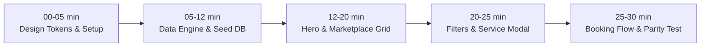

# Bollo.work Rapid 30-Minute Clone Playbook

This skill provides an exhaustive, production-grade specification and automated blueprint to replicate the entire user experience, visual identity, and core functionalities of **[bollo.work](https://www.bollo.work)** — Cameroon’s leading marketplace connecting households and businesses with 500+ verified service providers.

---

## 1. Design System & Brand Identity

To achieve pixel-for-pixel fidelity with `bollo.work`, enforce the following design specifications:

### Colors & Palette
- **Primary Brand Teal**: `#0d7377` (Deep emerald-teal used for primary headers, buttons, active tabs, and branding)
- **Primary Teal Hover**: `#0a5a5d`
- **Secondary Accent**: `#14ffec` (Vibrant cyan/teal used for highlights and interactive indicators)
- **Background Light**: `#f8fafc` / `#ffffff`
- **Surface Card**: `#ffffff` with subtle border `#e2e8f0` and soft elevation `0 4px 12px rgba(13, 115, 119, 0.06)`
- **Text Main**: `#0f172a` (Slate 900)
- **Text Muted**: `#64748b` (Slate 500)
- **Success / Verified**: `#10b981` (Emerald green verified check badge)
- **Star Rating Amber**: `#f59e0b`

### Typography
- **Headings & Display**: `Plus Jakarta Sans`, sans-serif (Weights: 600, 700, 800)
- **Body & Controls**: `DM Sans`, sans-serif (Weights: 400, 500, 600)
- **Numbers & Prices**: Bold tabular lining figures with `"XAF"` currency tag.

### Geometry & Shape
- **Corner Radius**: Modern rounded aesthetic:
  - Search Bar: `9999px` (Full pill shape) or `16px` rounded container
  - Service Cards: `16px` (`rounded-2xl`)
  - Badges & Pills: `9999px` (`rounded-full`)
  - Buttons: `12px` or `9999px` depending on role

---

## 2. Core Feature Set & Route Map

| Route | Feature Scope | Exact Bollo.work Behavior |
| :--- | :--- | :--- |
| `/` | **Home Landing** | Hero with 3-field search bar (Service, Town, Price/Category), Category Grid (7 core sectors), Featured Providers carousel, "Why Bollo" trust metrics, App Store/Google Play banner, and Footer. |
| `/services` | **Marketplace Catalog** | Live faceted search: Filter by Cameroon Town (Douala, Yaoundé, Buea, Limbe, Bamenda), Category, Price Range (XAF), and Minimum Rating (4.0+, 4.5+). Dynamic card grid. |
| `/services/:listingId` | **Service Detail & Booking** | Gallery preview, provider profile with verification badge, reviews, hourly/task pricing in XAF, availability schedule, and "Book Now" wizard. |
| `/app/booking/:id` | **Mobile Deep Link** | Automatically opens or redirects to the native mobile app task booking intent. |
| `/contact` | **Support & Inquiries** | WhatsApp direct concierge, contact form, Douala office email. |
| `/terms` & `/privacy` | **Legal & Policy** | Terms of service and privacy compliance for Cameroon (CEMAC regulations). |

---

## 3. The 30-Minute Sprint Timeline



### Minutes 00:00 – 05:00: Project Initialization & Theme
1. Set up Tailwind CSS with the Bollo palette:
   - Primary: `#0d7377`
   - Secondary: `#14ffec`
   - Fonts: `Plus Jakarta Sans` and `DM Sans`
2. Configure Google Fonts preconnect in `index.html`.

### Minutes 05:00 – 12:00: Data Engine & Service Catalog
1. Import `seed_bollo_db.json` from this skill's `scripts/` folder.
2. Initialize reactive signals/state for:
   - `searchQuery` (service/job title)
   - `selectedCity` (`all`, `douala`, `yaounde`, `buea`, `limbe`, `bamenda`)
   - `selectedCategory` (`repairs`, `cleaning`, `home`, `auto`, `beauty`, `catering`, `it`)
   - `maxPrice` (up to 100,000 XAF)
   - `minRating` (any, 4.0+, 4.5+)

### Minutes 12:00 – 20:00: Hero Section & Marketplace UI
1. Build the Hero component:
   - Pill search container with 3 inputs: *"What task do you need done?"*, *"Town in Cameroon"*, and *"Find Provider"* CTA.
   - Trust badge: *"500+ Verified Pros across Douala, Yaoundé & Buea"*.
2. Build the Category Grid with vibrant icons:
   - Repairs & AC Maintenance
   - Home & Deep Cleaning
   - Auto Mechanics & Diagnostics
   - House Moving & Trucking
   - Beauty & Braiding
   - Event Catering
   - IT & CCTV Support

### Minutes 20:00 – 25:00: Listing Cards & Filtering Logic
1. Build the Service Listing Card:
   - 16:9 high-resolution service photography with favorite button.
   - Provider avatar, full name, and green checkmark verified badge.
   - Star rating (e.g. `4.9 ★ (84 reviews)`).
   - Price chip in XAF (e.g. `15,000 XAF`).
   - Location chip (e.g. `Bonapriso, Douala`).
2. Implement instant reactive filtering without page reloads.

### Minutes 25:00 – 30:00: Booking Flow & Mobile Deep Link
1. Build the Booking Modal:
   - Service name & estimated XAF price.
   - Date & Time picker.
   - Customer phone number (+237 Cameroon format).
   - "Confirm & Send to Provider on WhatsApp" instant action.
2. Add the Mobile Download Banner ("Available on Android & iOS").

---

## 4. One-Click Rapid Scaffolder

Run the bundled automator script to generate the entire standalone app in seconds:

```bash
node .agents/skills/bollo-clone/scripts/scaffold_bollo.js
```

This creates an immediately runnable, responsive clone with all mock data and styling matching `bollo.work`.
